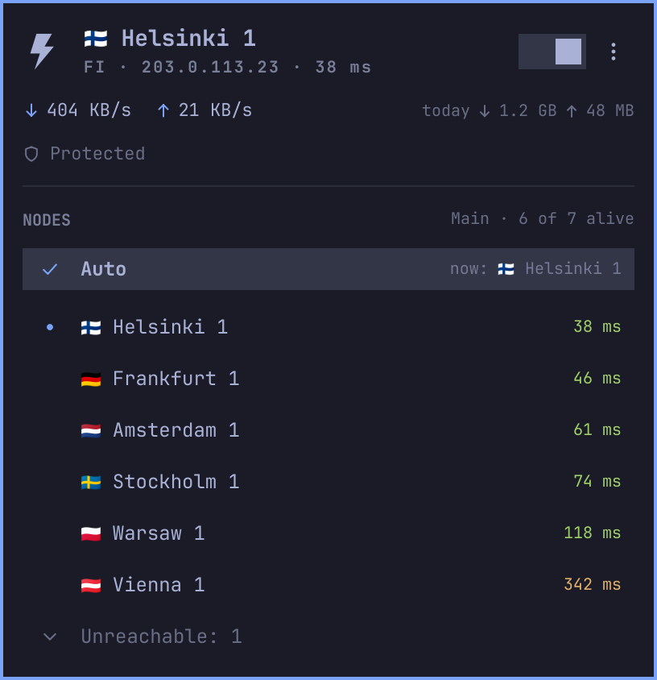
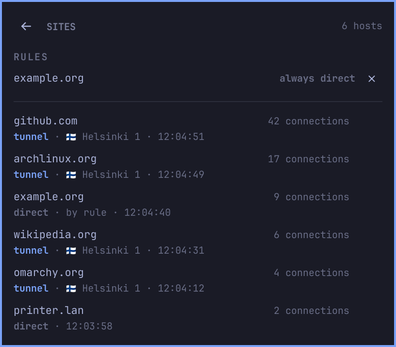
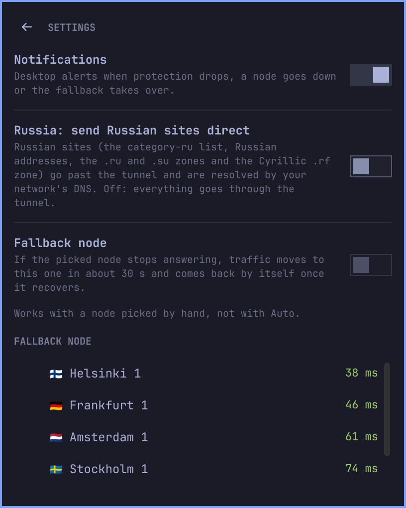
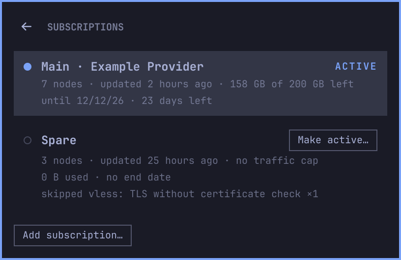
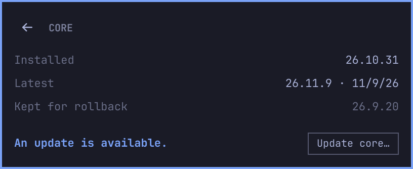
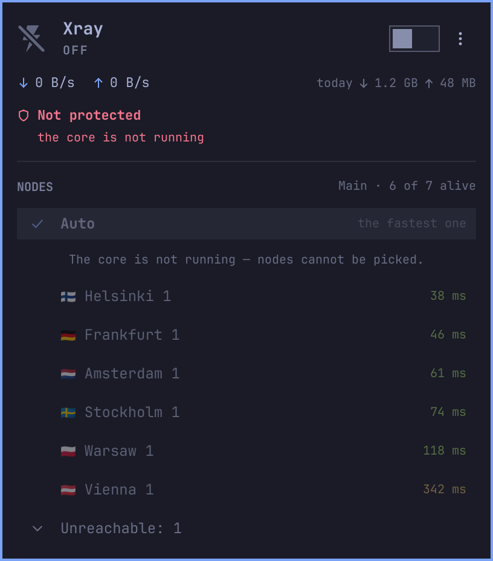
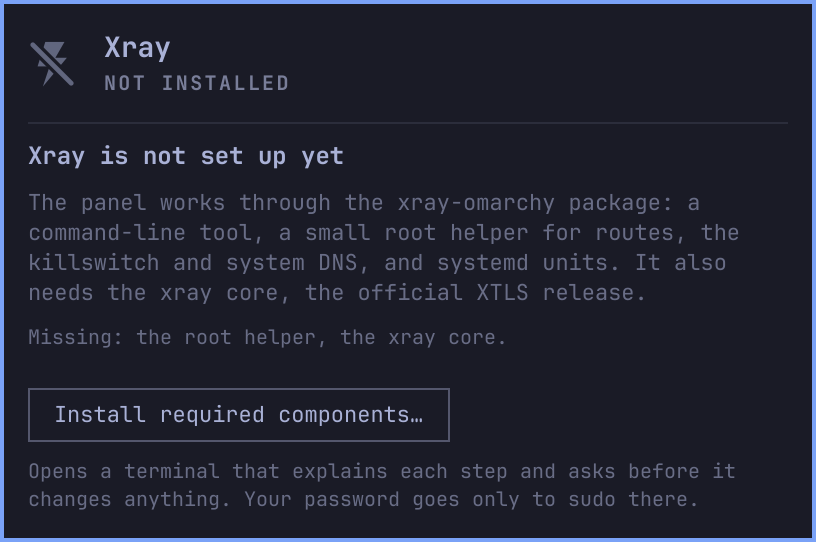
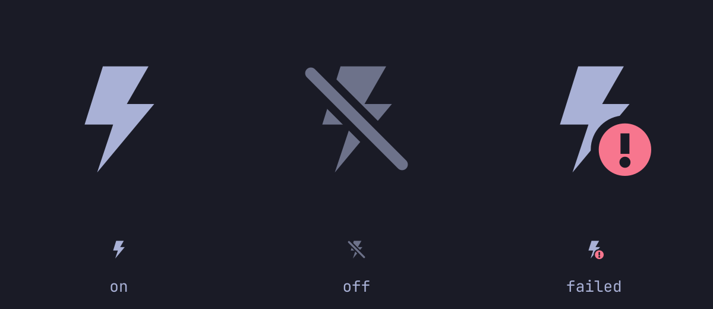

# Xray for Omarchy

A VPN client for [Omarchy](https://omarchy.org) that lives in the bar and runs
on the [Xray](https://github.com/XTLS/Xray-core) core. One xray process holds a
TUN device for the whole system, the routing, DNS on 127.0.0.1 and the choice
of node; an nftables killswitch keeps this machine's own traffic from leaving
outside the tunnel, also from boot (see Limitations for what it does not cover).



*Screenshots are taken on a test stand with made-up node names and addresses
from the documentation ranges; no real server is shown.*

- **Protocols.** Subscriptions of `vless://` (REALITY, XHTTP, TLS, WebSocket,
  gRPC…), `trojan://`, `ss://` (Shadowsocks), `vmess://` and `hysteria2://`
  links, plain or base64, and xray JSON profiles with their own balancers.
- **Whole system, one switch.** A TUN device (`xray-omarchy0`) for every
  program, not a proxy setting each app has to honour.
- **Killswitch.** An nftables table refuses anything that tries to go out
  past the tunnel, at once (TCP reset, ICMP "administratively prohibited"),
  so programs fail fast instead of hanging; it is loaded at boot before the
  network if it was on. If the routes into the tunnel cannot be set, the tunnel
  is not left running without them: systemd starts it again (every 2 s, then
  up to every 30 s) until they can, the bar shows the bolt with a warning
  badge and the panel says "traffic is not routed into the tunnel".
- **Split DNS.** Local networks, Tailscale and the zones you send direct are
  resolved by your network's own DNS; everything else by the core, through
  the tunnel.
- **Nodes by delay**, with search and an *Auto* mode that picks the fastest.
- **Per-site rules**: from the Sites page, "always direct" or "always via
  the tunnel" for a host you see there.
- **Fallback node** (off by default): if the node you picked stops
  answering, traffic moves to the fallback in about 30 s and comes back by
  itself.
- **Russia preset** (off by default): Russian sites (`category-ru`,
  `geoip:ru`, the `.ru`, `.su` and `xn--p1ai` zones) go direct.
- **Notifications** when protection drops, a node goes down or the fallback
  takes over.
- **Core updates** from the panel: official XTLS releases only, checked
  against SHA-256 sums the package pins.
- English and Russian, following Omarchy's language setting.

## Screenshots

| Sites and rules | Settings |
|---|---|
|  |  |
| **Subscriptions** | **Core** |
|  |  |
| **Switched off** | **First run** |
|  |  |

The bar icon: on, off, failed.



## Install

```
omarchy plugin add https://github.com/grigabyte/xray-omarchy.git --enable
```

Open the widget and press **Install required components…**. A terminal opens,
says what it will install and asks before doing anything. Then, as a
separate step, it lists what the root helper may do without a password and
asks you to type `HELPER`. After that it installs the dependencies with
pacman, builds the `xray-omarchy` package from `backend/` with `makepkg` and
installs it with pacman (sudo asks for your password once, for pacman),
installs the xray core and offers to add a subscription. You can also run it
yourself: `~/.config/omarchy/plugins/grigabyte.xray-omarchy/backend/install.sh`.

On a fresh Omarchy that has never run `omarchy update`, pacman's package
databases are the installer's offline copy and do not have
`v2ray-geoip` and `v2ray-domain-list-community`. The installer does not
sync them itself (`pacman -Sy` without the upgrade is a partial upgrade,
which Arch does not support): the panel says "Your package databases are out
of date. Run `omarchy update` first, then press
Install again." and opens nothing.

When the plugin is newer than the installed package, the panel shows
**Update components…**, which runs the same script.

After `omarchy plugin update` the shell keeps running the panel's old code
until it restarts. The panel notices (the manifest on disk is newer than the
code that runs) and offers **Restart the shell**, which runs
`omarchy restart shell`; you can also run that yourself.

Requirements: Omarchy (Arch) on x86_64 with NetworkManager, your user in the
`wheel` group. Dependencies come from Arch's `core` and `extra` repositories: `python`,
`sudo`, `systemd`, `iproute2`, `nftables`, `networkmanager`, `libcap`,
`libnotify`, `curl`, `v2ray-geoip`, `v2ray-domain-list-community`.

## What is installed, and what runs as root

| Path | What |
|---|---|
| `/usr/bin/xray-omarchy` | the CLI the panel talks to (`xray-omarchy --help`); runs as you |
| `/usr/lib/xray-omarchy/xray-omarchy-helper` | the only part that runs as root (below) |
| `/etc/sudoers.d/xray-omarchy` | lets members of `wheel` run that helper, and only it, without a password (checked with `visudo -cf` on install, removed if it does not pass) |
| `/usr/share/xray-omarchy/core-sums.json` | the SHA-256 of each xray release the helper may install |
| `/usr/lib/systemd/user/xray-omarchy*.{service,timer}` | the tunnel, subscription updates (every 6 h), traffic accounting, notifications |
| `/usr/lib/systemd/system/xray-omarchy-killswitch.service` | loads the killswitch at boot, before the network, if it was on; enabled on install (`systemctl enable`), disabled on removal |

**The root helper** takes a closed list of actions and checks every
argument; anything else is refused. It can:

- add and remove the ip rules that send IPv4 into `xray-omarchy0`, only while
  that device is held by *your own* running core (it checks `/proc/<pid>/exe`
  is the staged core binary, run by the uid that called sudo);
- load and remove the killswitch table `inet xray-omarchy`, and report
  whether the loaded table was changed behind its back;
- point the DNS of the active NetworkManager connection at the core, after
  saving that connection's own DNS settings, and later put them back exactly;
- install an xray release into `/var/lib/xray-omarchy/core/` (see below),
  switch to it, roll back;
- undo all of the above (`reset`, run when the package is removed).

It does not run commands you pass it, does not write files other than its
own under `/var/lib/xray-omarchy/` (NetworkManager stores the DNS change in
the connection's profile), and gives capabilities to no binary other than a
pinned xray release.

**What the passwordless rule means for you.** Any program running as a
member of `wheel` can call the helper without asking, with any of the
actions above. Several of them lower protection: such a program can turn
the killswitch off, take the routes down, put the network's DNS back, run
`reset` (which removes the installed core too), or install and switch to
any other xray release the package pins, all without a password prompt. It gets
nothing outside that list. If that trade is not acceptable, do not install
the package; the panel does nothing without it.

**The xray core and its checksum.** `xray-omarchy core update` (the panel's
Core page) downloads `Xray-linux-64.zip` of the newest version the package
pins, only from `https://github.com/XTLS/Xray-core/releases/download/`, as
you. The helper copies it into its own directory, compares the SHA-256 of
its copy with `/usr/share/xray-omarchy/core-sums.json`, and only then unpacks
`xray` into `/var/lib/xray-omarchy/core/<version>/` and gives it
`CAP_NET_ADMIN` and `CAP_NET_BIND_SERVICE`. The directory is `0750 root:wheel`,
so the binary is executable only by root and `wheel`. `core/current` is the
active version, `core/previous` the one kept for rollback; a failed update
rolls back by itself.

- *What the check protects against:* a damaged or swapped download, a mirror
  or proxy in between, a release file replaced after its sum was pinned, and
  using the passwordless helper to give network capabilities to some other
  program.
- *What it does not protect against:* a malicious release published before it
  was pinned. The sums are taken from the release's own `.dgst` by
  `backend/pin-core.sh`, so they mean "the same file this package was made
  for", not "a safe file". A newer XTLS release than the package pins is not
  installed; it arrives with a package update (the Core page says so).

**Your data**: settings and subscriptions in `~/.config/xray-omarchy/` (mode
0600), state in `~/.local/state/xray-omarchy/`, downloaded core archives in
`~/.cache/xray-omarchy/`, geo data links in `~/.local/share/xray-omarchy/`. Root's: `/var/lib/xray-omarchy/` with the
killswitch flag, the saved DNS settings of each connection it switched
(`dns/<uuid>.json`) and the core.

## Remove

```
~/.config/omarchy/plugins/grigabyte.xray-omarchy/backend/uninstall.sh   # or: sudo pacman -R xray-omarchy
omarchy plugin remove grigabyte.xray-omarchy
```

Removing the package takes the tunnel down for logged-in users, puts the ip
rules, the nftables table and each connection's DNS settings back exactly as
saved, and deletes `/var/lib/xray-omarchy` with the core and its
capabilities. Your data in `~/.config`, `~/.local` and `~/.cache` stays
unless `uninstall.sh --purge` (or its question) removes it. Users who were
not logged in at removal keep links to the removed user units in
`~/.config/systemd/user/*.wants/`; they point nowhere and do nothing
(`systemctl --user disable xray-omarchy.service` clears them).

## Why the Xray core

Other VPN plugins for Omarchy, such as
[omarchy-mihoro](https://github.com/huacnlee/omarchy-mihoro) and
[OmaVLESS](https://github.com/k-kostin/omavless), are built on
[mihomo](https://github.com/MetaCubeX/mihomo), a capable core with its own
rule language and wide protocol support. This plugin runs XTLS's own Xray
instead, because that is where VLESS, REALITY and the XHTTP transport are
developed: new transport options land there first, xray JSON profiles from a
provider work as they are, and a subscription made for Xray clients needs no
translation. If your provider's links already work well in a mihomo client,
either choice is fine; if they are made for Xray (XHTTP, VLESS
encryption, xray JSON), this one runs them natively.

## Limitations

- x86_64 only: the pinned core sums are for `Xray-linux-64.zip`.
- IPv4 only through the tunnel. With the killswitch on, IPv6 to the internet
  is refused at once (TCP reset, ICMPv6 "administratively prohibited"), so
  programs fall back to IPv4 instead of hanging; the connection's IPv6 DNS
  from the router is switched off while the tunnel is on, and DNS to
  link-local IPv6 addresses is blocked.
- NetworkManager is required: the network, its DNS and DHCP server are
  detected through it.
- Clash/mihomo YAML subscriptions are not read; the provider's v2ray-style
  link list or xray JSON is needed.
- One active subscription at a time; switching restarts the core (a second
  or two without connection).
- The killswitch guards this machine's own traffic (the output hook). Traffic
  it forwards for containers, VMs or a shared connection is not filtered: if
  the core is down, that traffic goes out directly.
- Tailscale is let past the tunnel and the killswitch (its interface and its
  packet mark), so the tailnet keeps working when the tunnel is down. With a
  Tailscale exit node, internet traffic goes through Tailscale, not the tunnel.
- Node host names, local and direct zones are resolved by your network's DNS
  (the router, or the resolver set in the connection), outside the tunnel and
  in plain DNS. If the connection has a public resolver set by hand (say
  9.9.9.9), that resolver sees those names.

## Settings

`~/.config/xray-omarchy/settings.json`, all optional (an empty file means:
detect): `lan_domains`, `direct_geo` (`geosite`, `geoip`, `domains` that go
direct; empty by default), `local_nets`, `lan_dns`, `notify`. The network
interface, the NetworkManager connection, the network's DNS and DHCP server
are detected. `local_nets` may hold only private (10/8, 172.16/12,
192.168/16), CGNAT (100.64/10), link-local (169.254/16, fe80::/10) and ULA
(fc00::/7) networks: anything wider or public would open the killswitch, so
a list with such a value falls back to the defaults and `xray-omarchy status`
shows a warning. The network's DNS and DHCP servers are let past the
killswitch only inside those networks: other programs cannot reach a public
resolver past the killswitch, but the core itself still asks it for node
names and local zones (a warning in `xray-omarchy status` says so). Subscriptions are fetched over https; a
plain `http://` link is refused (`insecure_url`) unless added with
`xray-omarchy sub add --allow-http` (the panel asks separately), and an https
link is never followed to http. `xray-omarchy preset russia on|off` (the
Settings switch) adds or removes `category-ru`, `geoip:ru` and the `ru`,
`su`, `xn--p1ai` zones.

## The panel

One screen, shaped like the shell's Tailscale panel: the node, exit address
and delay in the header with the on/off switch and a menu; one line of speed
and today's traffic; one line of protection (problems and core errors only
when there are any); the node list (Auto on top, the nodes that answer by
delay, the dead folded; search past ten nodes; the order holds while the
panel is open). The menu opens **Subscriptions**, **Sites**, **Settings** and
**Core** as second pages and runs a subscription update. While traffic goes
through the fallback node the main screen says so in one line.

Keys: `↑`/`↓` move over the nodes, `Enter` picks the one under the cursor or
opens the fold, `/` or `f` searches, `s` subscriptions, `c` sites, `m` the
menu, `u` update subscriptions, `r` refresh, `Esc` or `←` back from a second
page, `Esc` closes. Nothing on the keyboard turns the tunnel off or switches
the subscription.

IPC (`omarchy-shell grigabyte.xray-omarchy <verb>`): `open`, `close`,
`toggle`, `refresh`, `showPage main|subs|sites|settings|core|addsub|menu`,
`filter <text>`, `select <id|auto>`, `status`.

## Development

`make validate` runs the tests and `omarchy plugin validate`;
`make qml-check` lints the QML against the shell's modules;
`backend/update-sums.sh` refreshes the PKGBUILD checksums after a change to
a packaged file. `DESIGN.md` describes the panel and the reasons behind it.

## License

MIT, see [LICENSE](LICENSE). Xray-core, downloaded at install time from the
XTLS releases, is distributed under the MPL-2.0 by its authors.
